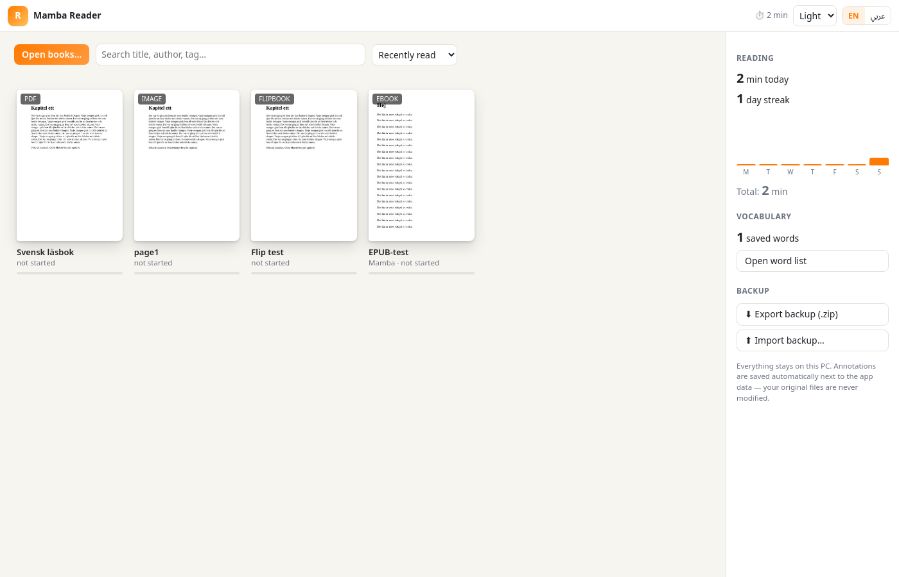
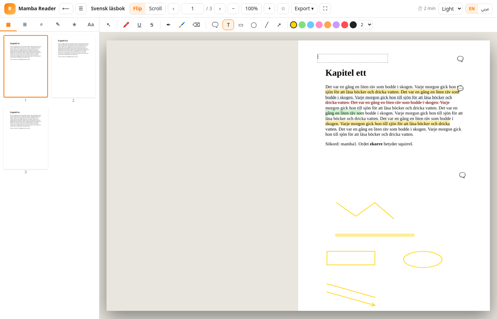
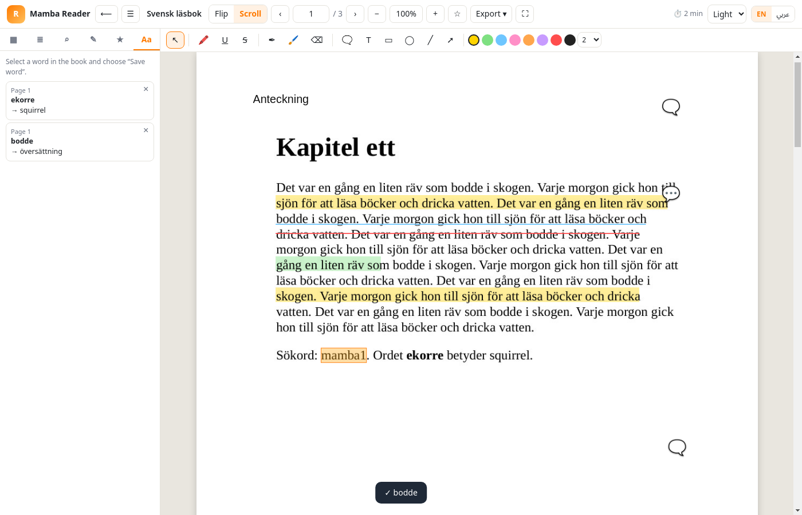
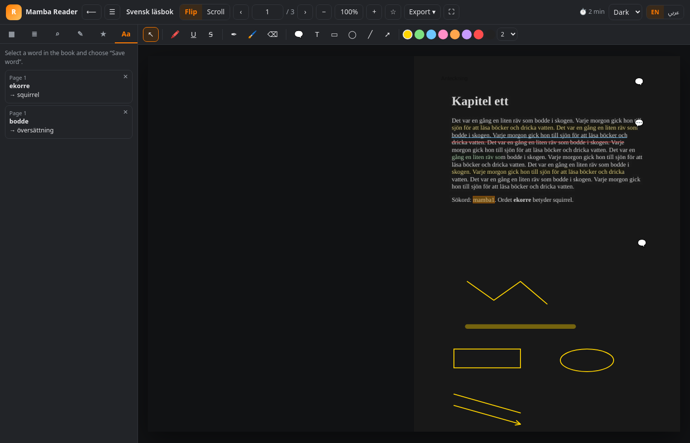
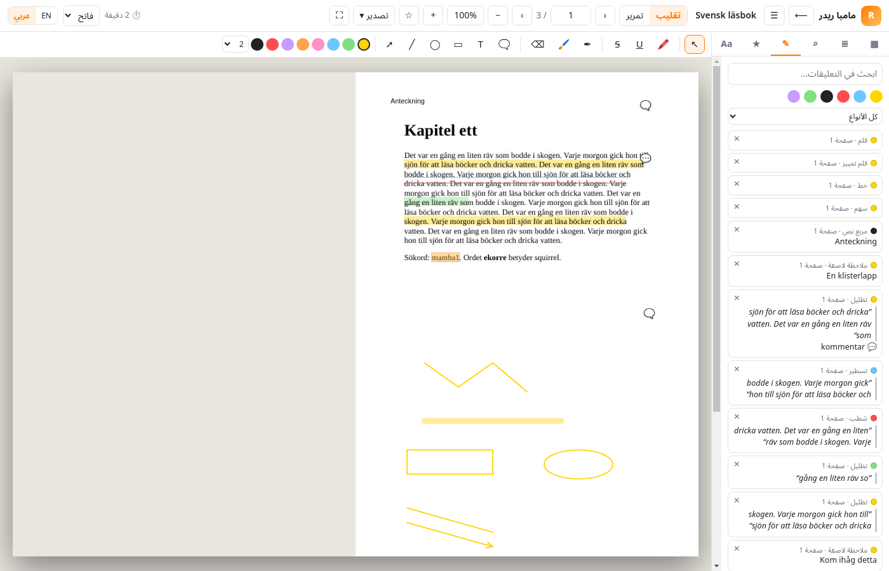

# Mamba Reader

A free, offline reader for Windows (x64). It opens PDFs, EPUBs, comics, images and **Mamba Convert** flipbooks, and lets you annotate them. Nothing is uploaded; the app makes no network requests at all. Your original files are never modified.




| Scroll mode | Dark theme | Arabic (RTL) |
|---|---|---|
|  |  |  |

## Download
Grab the latest version from **[Releases](https://github.com/heisenberg0066/mamba-reader/releases/latest)**:

* `MambaReader-Setup-x.y.z-x64.exe`: the installer. It installs per user, needs no admin rights, and goes to `%LOCALAPPDATA%\Programs\Mamba Reader\Mamba Reader.exe`.
* `MambaReader-Portable-x.y.z-x64.exe`: a single exe that needs no install.
* `MambaReader-x.y.z-win-x64.zip`: unzip and run `Mamba Reader.exe`.

The builds are not code-signed, so Windows SmartScreen may warn you. Click **More info → Run anyway**.

## Features
* **Library shelf**
  * Covers, a progress bar and "continue reading".
  * Search, sorting and per-book **tags**.
  * Drag & drop or *Open books…*.
  * A missing file can be re-linked.
* **Formats**
  * PDF, EPUB, MOBI, FB2, CBZ, XPS/OXPS.
  * Images: PNG, JPG, WebP, GIF, BMP, TIFF.
  * Mamba Convert flipbooks: single `.html` files or the `index.html` folder variant.
* **Reading**
  * Page-flip view with two-page spreads, using the same engine as Mamba Convert's flipbooks.
  * Continuous scroll mode, zoom, a thumbnail sidebar, go to page, full screen.
  * Keyboard navigation. Resume where you left off.
* **Annotations**
  * Text highlights in 8 colours, underline and strikethrough.
  * Pen, marker and eraser.
  * Sticky notes, either on the page or as a comment on a highlight.
  * Text boxes, rectangles, ellipses, lines and arrows; bookmarks.
  * Undo with Ctrl+Z.
* **Annotations panel**: full-text search, a colour and type filter, and click to jump.
* **Export**
  * Notes as Markdown, TXT or a PDF summary.
  * An annotated **copy** of the PDF with real PDF annotations (Highlight, Ink, FreeText, …) that any PDF viewer can show.
* **Search and outline**: full-text search (case-insensitive) and the PDF outline / table of contents.
* **Vocabulary**: select a word and choose **Save word** to store it with your own translation and note, for example while reading Swedish books. There is a manager with CSV export.
* **Reading timer**: minutes per day, a streak and a 7-day chart. It only counts while you are active.
* **Themes**: light, sepia and dark. The interface is in **English and Arabic (RTL)**.
* **Data**
  * Autosaves to sidecar JSON in `%APPDATA%\Mamba Reader`.
  * Backup export and import as a `.zip`. Import merges, and the newest annotation wins.

### Keyboard shortcuts
| Key | Action |
|---|---|
| ← / → / PgUp / PgDn / Space | previous / next page |
| Home / End | first / last page |
| Ctrl + / Ctrl − / Ctrl + wheel | zoom |
| Ctrl F | search in the book |
| B | bookmark the page |
| V / H / P | select / highlight / pen tool |
| Ctrl Z | undo the last annotation change |
| Esc | close popups, back to the select tool |
| F11 | full screen |

## Integration with Mamba Convert
The installer registers the `mamba-reader://` protocol and adds Mamba Reader to *Open with* for .pdf, .epub, .cbz, .xps, .oxps, .fb2 and .mobi. It never changes your default PDF app. The uninstaller removes these entries again.

* `"Mamba Reader.exe" "C:\path\book.pdf"` opens a file. If Reader is already running, the file opens in the same window.
* `mamba-reader://open?path=<url-encoded path>&page=<n>` does the same through the protocol.

Mamba Convert's **Open in Mamba Reader** button uses the exe path and falls back to the protocol.

## Self-test
`"Mamba Reader.exe" --self-test` creates sample books and checks the following:
* rendering, text, search and outline;
* every annotation type, plus the notes and annotated-PDF exports;
* EPUB, image and flipbook opening;
* vocabulary, the timer and backup;
* handoff parsing.

The report is written to `%APPDATA%\Mamba Reader\selftest-report.txt`.

## Development
```bash
npm install
npm start              # run
npm test               # Node tests (MuPDF worker, store, notes, backup)
bash test/run-ui.sh    # Linux: self-test + UI test under xvfb, screenshots into docs/
npx electron-builder --win --x64   # Setup, Portable and zip into dist/
```
The rendering engine is MuPDF (WebAssembly, `mupdf` npm), running in a worker thread. The CI workflow does the following on `windows-latest`:
1. Builds the app and runs the self-test and the UI test on the packaged exe.
2. Installs it silently and checks the install path and the registry keys.
3. Checks the argv and `mamba-reader://` handoff end to end through `handoff.log`.
4. Uninstalls it and checks that the registry was cleaned.

License: MIT. Free for personal use.
